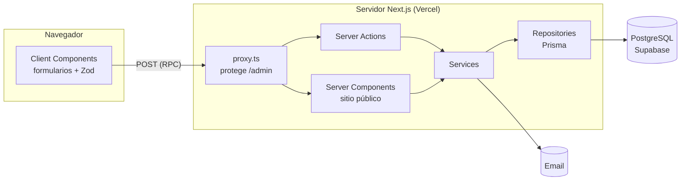

# Arquitectura

Cómo está armado el sistema, qué puede depender de qué y por qué. Las reglas duras están resumidas en
[`AGENTS.md`](../AGENTS.md); acá está el detalle. Cómo se ve está en [`DESIGN.md`](../DESIGN.md).

> Esta arquitectura se tomó de *gestor-empanaderia*, donde ya está probada, y se adaptó a Prisma y Supabase Auth.

## Vista general

Una sola aplicación **Next.js 16 (App Router)** con dos caras:

| Cara | Rutas | Quién la usa | Cómo renderiza |
|---|---|---|---|
| Sitio público | `/` (home, con «Dónde atiendo»), `/reservar`, `/login` (el mismo para todos), `/turno/[token]` (Sprint 4) | Pacientes, sin cuenta | Server Components; la reserva y sus pasos, Client Components + Server Actions |
| Panel | `/admin/**` (agenda, turnos, bloqueos, pacientes, ubicaciones, ajustes, cuenta) | Lisandro (único admin), con login propio (JWT) | Server Components que leen con `guardAdminPage`; formularios Client Components + Server Actions |

**Estilo arquitectónico.** En ejecución es cliente-servidor; en despliegue, un monolito modular. El código se
agrupa por *feature* (`src/features/<feature>`), no por tipo técnico.

**Cliente y servidor se comunican por Server Actions, no por una API REST propia.** Los Route Handlers
(`src/app/api/**`) quedan para integraciones externas (webhooks). Hoy no hay ninguno.



### Stack

| Capa | Tecnología |
|---|---|
| Framework | Next.js 16 (App Router, Turbopack, Cache Components), React 19, TypeScript `strict` |
| UI | Tailwind CSS v4 + shadcn/ui, íconos Lucide. Tokens y componentes en `DESIGN.md` |
| Validación | Zod 4: el formulario y la action validan con el **mismo** schema |
| Datos | PostgreSQL 15 (Docker en local, Supabase en producción) + Prisma 7 con `@prisma/adapter-pg` |
| Autenticación | Login propio con JWT (`jose`), sólo para el panel (T-3, ADR 0004) |
| Email | Resend por su API REST, sin SDK (`src/lib/email/`). Sprint 2: desde local, sin dominio propio |
| Calidad | ESLint 9 (`eslint-config-next` + reglas duras en `eslint/`), Prettier, lefthook, commitlint y GitHub Actions |
| Tests | Vitest 5, Testing Library, fast-check, Stryker y Playwright. Ver [`testing.md`](testing.md) |

## Reglas de dependencia

```
ui (src/app, features/*/ui) → actions → services → repository → db
                                       domain: lo usan todas
```

| Desde | Puede importar | Nunca |
|---|---|---|
| `src/app/**` | `features/*/ui`, `features/*/actions`, `features/*/domain`, `components/`, `hooks/`, `config/`, `lib/utils` | `repository`, `services`, `@/lib/db`, `@/generated/prisma` |
| `features/<f>/ui` | `domain` y `actions` de cualquier feature, `components/`, `hooks/`, `config/` | `repository`, `services`, `@/lib/db` |
| `features/<f>/actions` | `services` propios, `requireAdmin` de `features/auth/actions/require-admin` (ADR 0004), `domain`, `lib/auth`, `lib/errors`, `lib/action-result` | `repository`, `@/lib/db`, `ui` |
| `features/<f>/services` | `repository` propio y, si la operación los abarca, de otros features; `domain`, `lib/errors`, `@/lib/db/transaction` | `actions`, `ui`, `next/*` |
| `features/<f>/repository` | `@/lib/db`, `@/generated/prisma`, tipos de `domain`, `lib/errors` | `services`, `actions`, `next/*` |
| `features/<f>/domain` | `zod` | `@/lib/db`, `@/generated/prisma`, `repository`, `next/*` |
| `src/components/**`, `src/lib/**` | librerías externas, `lib/` | `features/*` |

Por qué:

- **El navegador nunca importa código con acceso a datos.** `src/lib/db/index.ts` lleva `import 'server-only'`.
- **Las actions no llaman al repositorio.** Las reglas de negocio (disponibilidad, anticipación mínima, estados)
  se prueban sin Next.js ni base: viven en el service, con un repositorio fake.
- **Sólo el repositorio toca Prisma**, y los tipos generados no salen de ahí: `domain` define los tipos con Zod.
  Cambiar una query no obliga a tocar reglas.

ESLint (`eslint/layers.mjs`) hace cumplir esta tabla y prohíbe `$queryRaw` / `$executeRaw` en todo `src/`.

### Anatomía de un feature

```
src/features/<feature>/
  domain/       <feature>.schema.ts      Zod: entrada (create/update) y fila (row) + tipos inferidos
  repository/   <feature>.repository.ts  interfaz + Prisma; recibe la transacción
  services/     <feature>.service.ts     reglas de negocio; abre la transacción con withTransaction
  actions/      <operación>.ts           'use server': sesión → validación → service → ActionResult
  ui/           components/, hooks/      componentes propios del feature
  testing/      fake, builders y suite de comportamiento   sólo para tests
```

Features: `auth` (login y cuenta), `location` (ubicaciones y horarios), `settings` (duración y obras sociales) y
`agenda` (turnos, disponibilidad, bloqueos y emails). No hay `servicio`: todos los turnos duran lo mismo y no hay
tipos de consulta. Las lecturas que usa una página viven en `actions/*-queries.ts` (no son Server Actions): las del
panel llaman a `guardAdminPage()`; las públicas usan `'use cache'` con un tag que refrescan las actions (`updateTag`).

## Piezas transversales

| Ruta | Contenido |
|---|---|
| `src/app/tokens.css` | Tokens de `DESIGN.md` (colores, radios, sombras, fuente) para Tailwind y shadcn. Único lugar con hex; lo controla ESLint y su contraste lo prueba `tokens.test.ts`. |
| `src/proxy.ts` | Next 16 renombró `middleware.ts` a `proxy.ts`. En `/admin/**` verifica la firma del JWT de la cookie (sin base): si es válido y es una navegación real del navegador (GET con `sec-fetch-dest: document`), renueva la cookie (en actions y precargas no, para no revivir una sesión recién cerrada); si es inválido la borra; sin sesión, todo `/admin/**` se reescribe a `/acceso-denegado` (la URL no cambia; `noindex`). Responde 200: con Cache Components ni `forbidden()` ni una reescritura pueden fijar un 403. Es barrera de navegación, **no** de seguridad: cada action del panel vuelve a verificar la sesión. |
| `prisma/schema.prisma`, `prisma/migrations/` | Modelo de datos y migraciones versionadas. Las restricciones que Prisma no expresa (`CHECK`, `EXCLUDE`) van en el SQL de la migración. |
| `prisma.config.ts` | URL de las migraciones: `LOCAL_DATABASE_URL` en local y en tests; `DIRECT_URL` con `APP_ENV=production`. |
| `src/lib/db/index.ts` | Cliente Prisma único (`db`) con el adaptador de `pg`. La URL sale de `database-config.ts`: `LOCAL_DATABASE_URL`, o `DATABASE_URL` (pooler) con `APP_ENV=production`. |
| `src/lib/db/transaction.ts` | `withTransaction(work)`, `withSerializableTransaction(work)` y `DbTransaction`. La agenda la usa por `agendaRepository.inTransaction`, así el service no conoce Prisma y el fake corre igual. |
| `src/lib/email/` | `emailSenderFromEnv` (Resend por `fetch`), `renderEmail` (plantilla con los colores de `tokens.css`, verificados por test). Nunca se loguea el destinatario ni el contenido. |
| `src/lib/argentina-time.ts`, `src/lib/ics.ts`, `src/lib/whatsapp.ts` | Hora argentina ↔ UTC (`argentinaInstant`, `whenText`), archivo `.ics` y link `wa.me`. |
| `src/lib/errors/` | Catálogo de códigos (`codes.ts`) con su mensaje en español y `AppError(code)`. |
| `src/lib/action-result.ts` | `ActionResult<T>` y `fail(code)`: resultado tipado de toda action. |
| `src/lib/db-errors.ts` | `databaseErrorCode` y `toActionFailure`: traducen errores de Prisma y Postgres (`P2002`/`23505`/`23P01` → `DUPLICATE`, `P2003`/`23503` → `RELATION_NOT_FOUND`, `P2025` → `NOT_FOUND`, `P2034`/`40001` (conflicto de una transacción `Serializable`) → `STALE_VERSION`, datos inválidos → `VALIDATION`). `isExclusionViolation` deja que un repositorio traduzca un `EXCLUDE` a su código (`SLOT_TAKEN`, `HOURS_OVERLAP`). Un error desconocido da `UNEXPECTED` y se loguea **sin datos personales** (sólo nombre y códigos). Un borrado con dependencias lo traduce el repositorio a `HAS_RELATIONS`. |
| `src/lib/format-date-time.ts` | `formatDateTime`, `argentinaDay`, `argentinaTime`: todo se muestra en `America/Argentina/Buenos_Aires`. |

## Flujo de una mutación (ejemplo: reservar un turno)

1. **El cliente valida** con el schema de `domain` para dar feedback inmediato. No es una medida de seguridad.
2. **La action es la barrera real.** Las públicas (reservar, cancelar con token) aplican rate limiting y honeypot;
   las del panel verifican la sesión. Todas validan con `z.strictObject`.
3. **El service aplica las reglas** (horario disponible, anticipación mínima) y abre la transacción.
4. **La base garantiza lo que importa:** dos reservas simultáneas del mismo horario chocan contra la restricción y
   una recibe `SLOT_TAKEN`.
5. **La action nunca lanza hacia el cliente.** Devuelve `ActionResult`.

## Concurrencia optimista

| Pieza | Cómo funciona |
|---|---|
| Columna | `version Int @default(1)` en toda tabla que recibe `UPDATE`. |
| Escritura | El repositorio usa `updateMany({ where: { id, version } , data: { ..., version: { increment: 1 } } })`. |
| Conflicto | `count === 0` ⇒ `AppError('STALE_VERSION')`. |

## Seguridad

| Tema | Implementación |
|---|---|
| Autenticación | Login propio con JWT, un solo usuario admin (T-3, ADR 0004). |
| Acciones públicas | Lista cerrada en `AGENTS.md`, con rate limiting y honeypot. |
| Entrada / salida | `z.strictObject` en toda entrada; toda respuesta se parsea con su `*RowSchema`. |
| Datos personales | Ley 25.326: sólo lo necesario, consentimiento explícito y cero datos en logs. |
| Secretos | `.env.local` y `.env.prod`, ignorados por git. Toda variable nueva va a `.env.example`. |

## Entornos

| Entorno | Base | Configuración |
|---|---|---|
| Desarrollo | Docker `db` (puerto 5435) | `.env.local`: `LOCAL_DATABASE_URL` |
| Tests | Docker `db-test` (puerto 5436, `tmpfs`, perfil `test`) | `.env.test` (versionado) |
| Producción | Supabase | `APP_ENV=production` + `DATABASE_URL` (pooler) y `DIRECT_URL` (migraciones), en Vercel |

La base se elige con `APP_ENV`, nunca con `NODE_ENV` ([ADR 0002](adr/0002-la-base-se-elige-con-app-env.md)).
Los puertos 5435/5436 no chocan con los de gestor-empanaderia (5433/5434).
